<div align="center">

# 🎥 RAG Chatter

### Creator Video Intelligence & RAG Platform


<br/>
<br/>

<a href="https://rag-chatter-a9t5.vercel.app/">

</a>

<a href="https://github.com/kamlesh90256/rag-chatter">

</a>

<br/>
<br/>


<br/>
<br/>


</div>

---

# 🧠 What is RAG Chatter?

**RAG Chatter** is a production-oriented creator video intelligence
platform that compares a **YouTube video** with an **Instagram Reel**,
extracts metadata and transcripts, indexes transcript chunks as
embeddings, retrieves relevant evidence and uses an LLM to answer
creator-analysis questions.

The platform is designed around an important principle:

> **Retrieve evidence first. Generate reasoning second.**

```text
YouTube Video
      +
Instagram Reel
      ↓
Metadata Extraction
      ↓
Transcript Extraction
      ↓
Chunking
      ↓
Embeddings
      ↓
ChromaDB
      ↓
Semantic Retrieval
      ↓
Context Building
      ↓
LangGraph
      ↓
LLM
      ↓
Evidence-Backed Answer
```

The repository documents this exact workflow and returns citations in
the format `Source: Video Name | Chunk N`. 

---

# 🌐 Live Application

<div align="center">

## 🚀 Try RAG Chatter

<a href="https://rag-chatter-a9t5.vercel.app/">


</a>

<br/><br/>

**https://rag-chatter-a9t5.vercel.app/**

</div>

---

# 🎯 Problem

Creator analysis normally requires manually switching between multiple
sources.

```text
YouTube
   ↓
Watch Video
   ↓
Read Description
   ↓
Find Transcript
   ↓
Open Instagram
   ↓
Watch Reel
   ↓
Compare Hooks
   ↓
Compare Engagement
   ↓
Form Conclusions
```

This becomes slow and difficult when a creator needs to analyze many
videos.

---

# 💡 Solution

RAG Chatter turns that workflow into a structured intelligence pipeline.

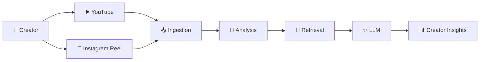

---

# ✨ Core Capabilities

<table>
<tr>

<td width="50%">

## 🎥 Video Ingestion

- YouTube URL validation
- Instagram Reel URL validation
- Metadata extraction
- Creator information
- Engagement information

</td>

<td width="50%">

## 📝 Transcript Intelligence

- Transcript extraction
- Fallback transcription
- Chunking
- Embeddings
- Semantic retrieval

</td>

</tr>

<tr>

<td width="50%">

## 🧠 RAG Analysis

- Retrieval-Augmented Generation
- Context building
- LangGraph memory
- Evidence-backed answers
- Source citations

</td>

<td width="50%">

## 📊 Creator Analytics

- Engagement comparison
- Hook analysis
- Video comparison
- Creator-level insights
- Conversational analysis

</td>

</tr>

<tr>

<td width="50%">

## 🌊 Real-Time UX

- SSE streaming
- Progressive answers
- Fast feedback
- Conversational interface

</td>

<td width="50%">

## ⚙️ Production Infrastructure

- Docker
- Docker Compose
- Redis
- Celery
- Flower
- Trivy
- Railway
- Vercel

</td>

</tr>
</table>

The documented feature set includes transcript-first extraction with a
`yt-dlp` + Whisper fallback, ChromaDB, LangGraph memory, streamed SSE
answers, citations and engagement/hook comparison. 

---

# 🏗️ Complete System Architecture

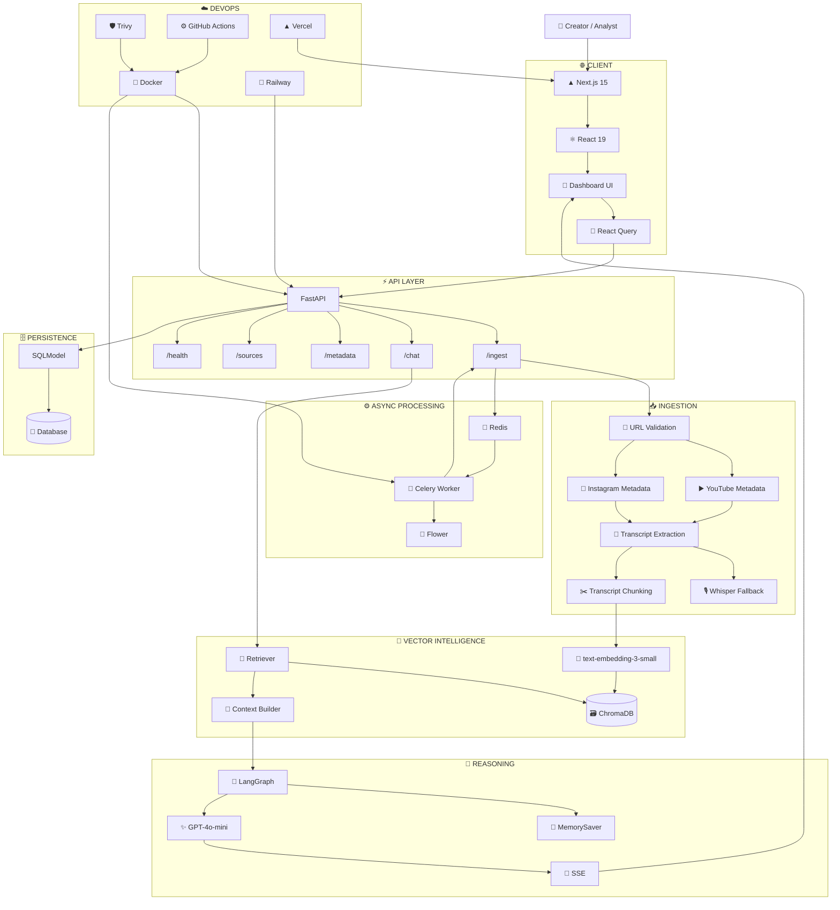

---

# 🔄 A-to-Z Architecture

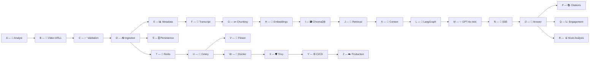

---

# 🎥 Video Intelligence Pipeline

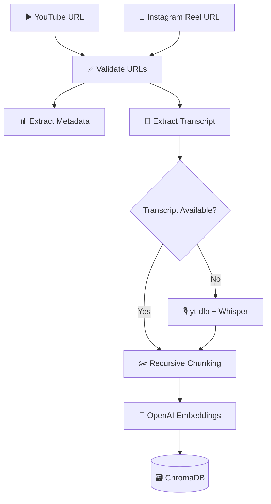

The documented ingestion flow uses `youtube-transcript-api` first and
falls back to `yt-dlp + Whisper`; transcript chunks are created using
`RecursiveCharacterTextSplitter`, then embedded and stored in ChromaDB. 

---

# 📝 Transcript Extraction Strategy

```text
                Transcript Request
                        │
                        ▼
             youtube-transcript-api
                        │
                 ┌──────┴──────┐
                 │             │
               Works        Fails
                 │             │
                 ▼             ▼
              Use Text     yt-dlp
                               │
                               ▼
                             Audio
                               │
                               ▼
                            Whisper
                               │
                               ▼
                          Transcript
```

The fallback improves resilience when a native YouTube transcript is
not available. 

---

# 🧠 RAG Architecture

RAG Chatter uses retrieval before generation.

```mermaid
flowchart LR

    QUESTION["❓ Creator Question"]

    EMBED["🔢 Query Embedding"]

    SEARCH["🔎 Similarity Search"]

    CHROMA[("🗃️ ChromaDB")]

    SOURCES["📚 Relevant Chunks"]

    CONTEXT["📄 Context Builder"]

    GRAPH["🧠 LangGraph"]

    LLM["✨ GPT-4o-mini"]

    RESPONSE["💬 Answer + Citations"]

    QUESTION --> EMBED
    EMBED --> SEARCH
    SEARCH --> CHROMA
    CHROMA --> SOURCES
    SOURCES --> CONTEXT
    CONTEXT --> GRAPH
    GRAPH --> LLM
    LLM --> RESPONSE
```

---

# 🔬 Retrieval Pipeline

```text
Creator Question
      ↓
Query Embedding
      ↓
Vector Similarity Search
      ↓
Top Relevant Chunks
      ↓
Source Metadata
      ↓
Context Builder
      ↓
LangGraph
      ↓
LLM
```

---

# 📚 Evidence & Citations

One of the important design decisions is that the system can return
source references with the response.

Example:

```text
Source: YouTube Video Name | Chunk 4
Source: Instagram Reel Name | Chunk 7
```

This gives the analyst a way to connect AI-generated reasoning back to
retrieved evidence.

---

# 💬 Conversational Analysis

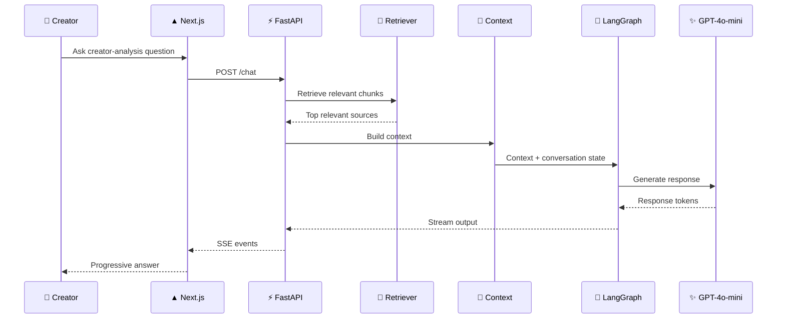

---

# 🌊 SSE Streaming

Instead of:

```text
Request
   ↓
Wait
   ↓
Full Answer
```

the platform provides:

```text
Request
   ↓
Token
   ↓
Token
   ↓
Token
   ↓
Token
   ↓
...
   ↓
Complete Answer
```

This creates a more responsive conversational experience.

The documented chat path returns streamed SSE responses. 

---

# 🧠 LangGraph Memory

The conversational layer uses LangGraph memory.

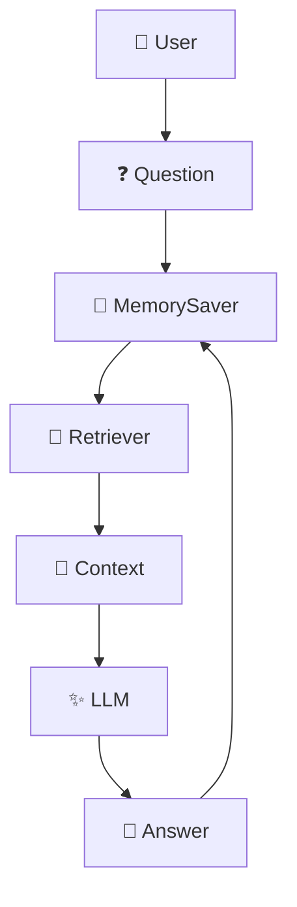

This allows the application to combine retrieval with conversational
state.

---

# 📊 Creator Analysis

The platform is designed to compare creator content using signals such
as:

```text
Engagement
   ↓
Likes
Comments
Views
Followers
```

and:

```text
Content
   ↓
Hook
Transcript
Context
Comparison
```

The current README explicitly includes engagement comparison and hook
performance analysis. 

---

# 🪝 Hook Analysis

Conceptually:

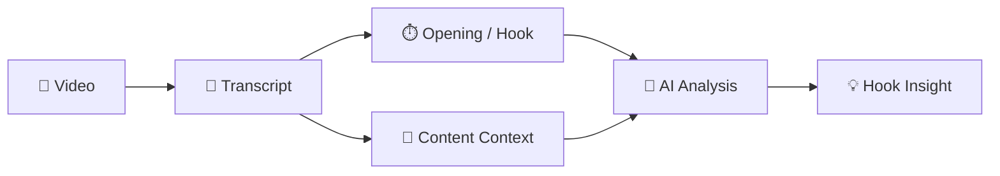

---

# ⚖️ Content Comparison

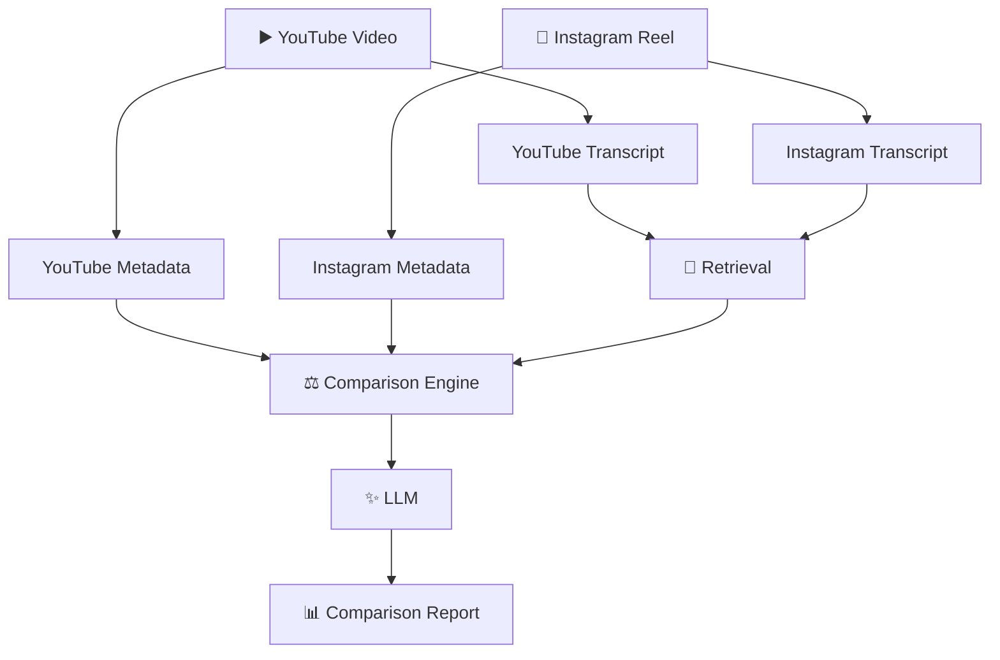

---

# 📡 API Architecture

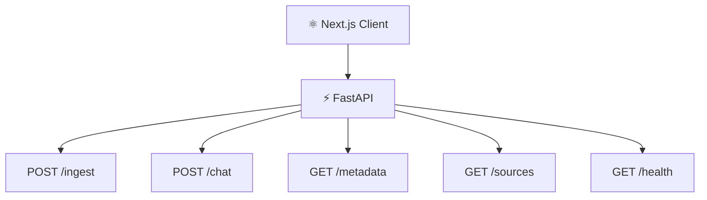

The repository documents these API endpoints. 

---

# 📥 `/ingest`

```http
POST /ingest
```

Responsible for accepting the creator's content sources and beginning
the ingestion pipeline.

```text
YouTube URL
      +
Instagram Reel URL
      ↓
Validation
      ↓
Metadata
      ↓
Transcript
      ↓
Chunking
      ↓
Embeddings
      ↓
Vector Store
```

---

# 💬 `/chat`

```http
POST /chat
```

Responsible for creator-analysis questions.

```text
Question
   ↓
Retriever
   ↓
Context
   ↓
LangGraph
   ↓
LLM
   ↓
SSE Response
```

---

# 📊 `/metadata`

```http
GET /metadata
```

Returns extracted content metadata.

---

# 📚 `/sources`

```http
GET /sources
```

Provides source information used by the retrieval/answering layer.

---

# ❤️ `/health`

```http
GET /health
```

Used for application health verification.

---

# 🗄️ Data Architecture

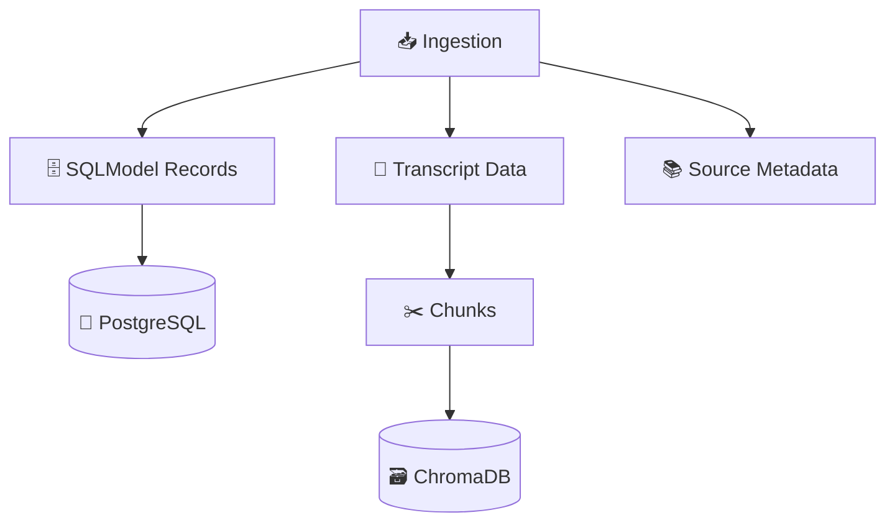

---

# 🧩 Storage Strategy

The architecture separates:

```text
Structured Application Data
          ↓
     SQLModel / DB

Semantic Knowledge
          ↓
       ChromaDB
```

This is useful because transactional/structured data and vector
retrieval have different access patterns.

---

# ⚙️ Async Processing Architecture

The repository includes Docker Compose support for Redis and Celery
workers. 

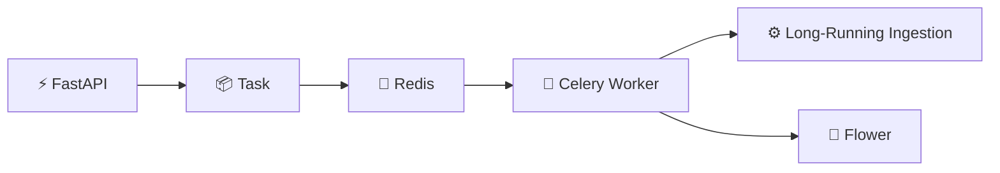

---

# 🐝 Why Celery?

Long-running ingestion tasks such as:

```text
Download
Transcript
Audio
Whisper
Chunking
Embeddings
Indexing
```

can be moved away from the interactive API request path.

Conceptually:

```text
HTTP Request
     ↓
Create Task
     ↓
Redis
     ↓
Celery Worker
     ↓
Long-Running Processing
```

---

# 🌸 Flower Monitoring

The Docker Compose environment includes a Flower service for monitoring
Celery workers.

```text
Celery Worker
     ↓
Flower
     ↓
Task Visibility
```

The documented development stack exposes Flower on port `5555`. 

---

# 🐳 Docker Architecture

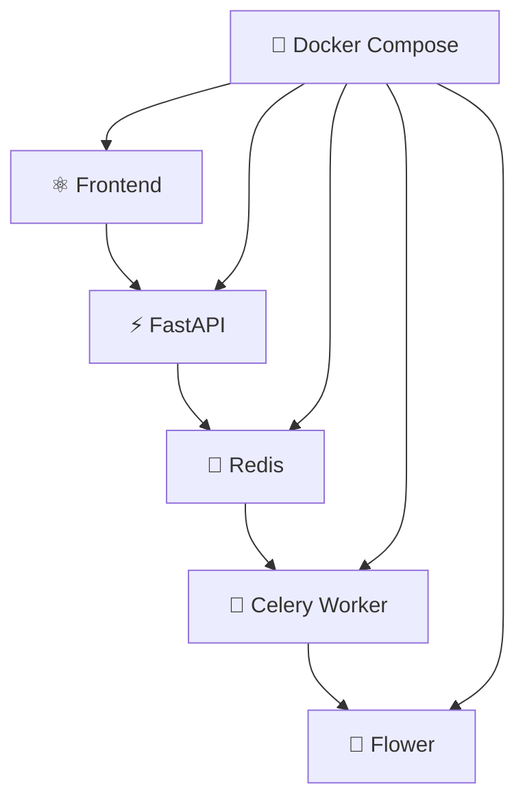

---

# 🛡️ Container Security

The repository includes Trivy scanning scripts for filesystem and
container-image scanning. 

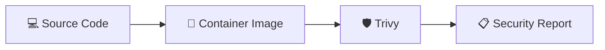

---

# ⚙️ Base Image Hardening

The project also documents a scheduled GitHub Action that can pin base
images to digests and open updates as pull requests. 

Conceptually:

```text
Base Image
    ↓
Digest Pinning
    ↓
Reproducible Build
    ↓
Security Update PR
```

---

# 🧱 Backend Structure

```text
backend/
│
├── api/
│
├── rag/
│
├── graph/
│
├── vectorstore/
│
├── ingest/
│
├── models/
│
├── utils/
│
├── tests/
│
├── alembic/
│
├── api/main.py
├── celery_app.py
└── ...
```

The existing repository README documents API, RAG, graph, vectorstore,
ingest, models, utils and tests as the major backend areas. 

---

# ⚛️ Frontend Structure

```text
frontend/
│
├── app/
│
├── components/
│
├── hooks/
│
├── services/
│
├── types/
│
├── package.json
└── ...
```

The actual frontend package uses Next.js 15, React 19, TypeScript,
Tailwind CSS, React Query and Vitest. 

---

# 🧠 RAG Module Responsibilities

```text
rag/
│
├── Retrieval
├── Context Preparation
└── RAG Orchestration
```

---

# 🔗 Graph Module

```text
graph/
│
├── LangGraph State
├── Memory
└── Conversational Workflow
```

---

# 🗃️ Vector Store

```text
vectorstore/
│
├── ChromaDB
├── Embeddings
└── Similarity Retrieval
```

---

# 📥 Ingestion Layer

```text
ingest/
│
├── URL Processing
├── Metadata
├── Transcript
├── Fallback Audio
├── Chunking
└── Indexing
```

---

# 📈 Scaling Architecture

The documented scaling plan targets roughly **1000 creators/day** by
adding caching, async workers, batched embeddings, horizontal FastAPI
scaling, managed vector storage and precomputed analysis. 

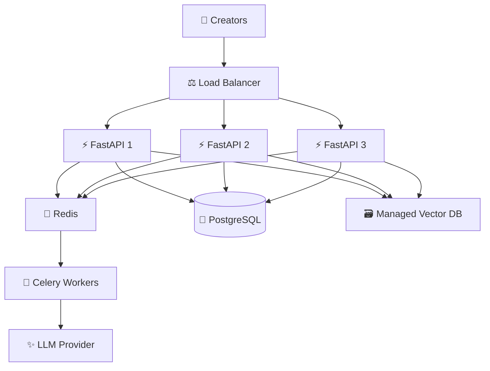

---

# 📈 Scaling Strategy

```text
Stage 1
Single Application
      ↓
Stage 2
Redis Cache
      ↓
Stage 3
Celery Workers
      ↓
Stage 4
Horizontal API Scaling
      ↓
Stage 5
Managed Vector Database
      ↓
Stage 6
Precomputed Analysis
      ↓
Stage 7
Production Observability
```

The documented strategy explicitly proposes Redis caching, Celery,
batched embeddings, horizontal FastAPI workers, managed vector
storage, and precomputed hook analysis. 

---

# 💰 Cost Architecture

Primary cost sources:

```text
OpenAI Embeddings
       +
GPT Token Usage
       +
Whisper
       +
Persistent Storage
```

The project documentation identifies these as the major cost areas. 

---

# 💡 Cost Optimization

```mermaid
flowchart LR

    INGEST["📥 Ingestion"]

    ONCE["🔂 Process Once"]

    EMBED["🔢 Reuse Embeddings"]

    RETRIEVE["🔎 Retrieve"]

    SHORT["📄 Keep Context Short"]

    CACHE["⚡ Cache"]

    WORKERS["🐝 Background Workers"]

    COST["💰 Lower Cost"]

    INGEST --> ONCE
    ONCE --> EMBED
    EMBED --> RETRIEVE
    RETRIEVE --> SHORT
    SHORT --> CACHE
    CACHE --> WORKERS
    WORKERS --> COST
```

Documented cost controls include reusing embeddings, retrieval before
generation, caching repeated comparisons and moving ingestion into
background jobs. 

---

# ⚖️ Architecture Tradeoffs

### ChromaDB

```text
Simple
+
Fast to integrate
+
Local persistence
```

Tradeoff:

```text
Large multi-tenant production
        ↓
Managed Vector DB
```

The repository explicitly identifies ChromaDB's simplicity as a benefit
and managed vector search as a better direction at larger scale.


### In-Process Rate Limiter

Current:

```text
Application Process
      ↓
Rate Limiter
```

Distributed future:

```text
Redis / API Gateway
      ↓
Centralized Enforcement
```

### Whisper Fallback

Benefit:

```text
Higher transcript resilience
```

Tradeoff:

```text
Additional compute / API cost
```

These tradeoffs are explicitly documented by the project. 

---

# 🔐 Security Model

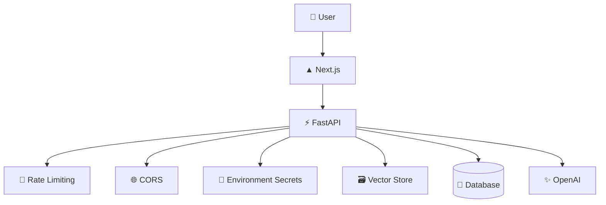

---

# 🧪 Testing Architecture

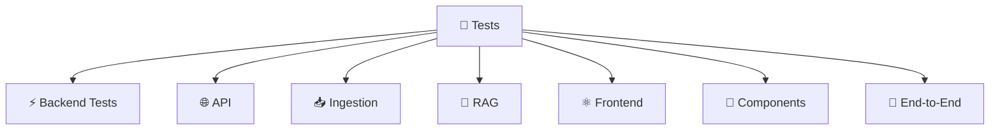

The frontend package includes a Vitest test command. 

---

# ⚙️ CI/CD Architecture

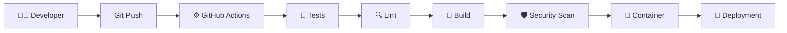

---

# ☁️ Deployment Architecture

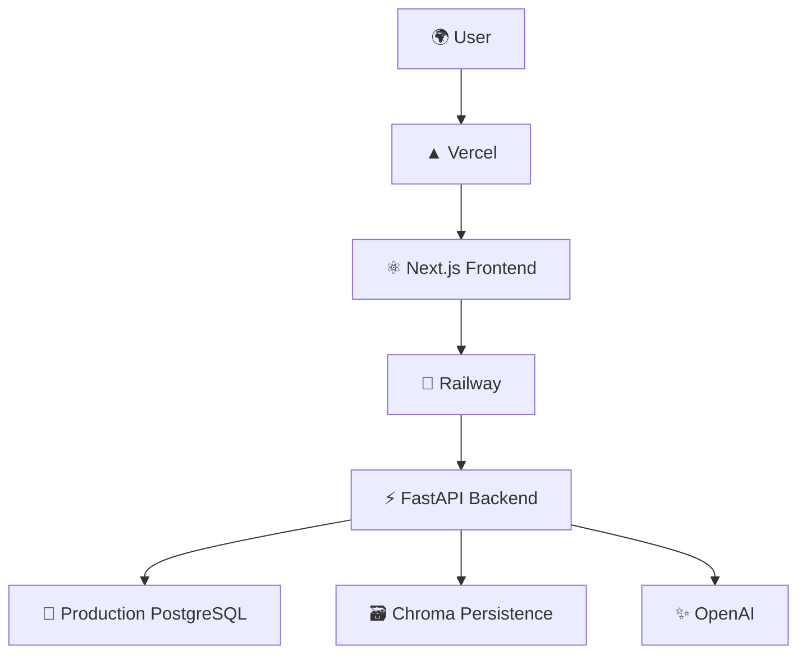

The current deployment documentation specifies Vercel for the frontend
and Railway for the backend. 

---

# 🔄 Complete End-to-End Flow

```mermaid
flowchart TB

    USER["👤 Creator"]

    URL["🔗 YouTube + Instagram URLs"]

    FRONTEND["⚛️ Next.js Dashboard"]

    API["⚡ FastAPI"]

    INGEST["📥 Ingestion"]

    METADATA["📊 Metadata"]

    TRANSCRIPT["📝 Transcript"]

    CHUNK["✂️ Chunk"]

    EMBED["🔢 Embed"]

    VECTOR[("🗃️ ChromaDB")]

    QUESTION["❓ Question"]

    RETRIEVE["🔎 Retrieve"]

    CONTEXT["📄 Context"]

    LANGGRAPH["🧠 LangGraph"]

    LLM["✨ GPT-4o-mini"]

    SSE["🌊 SSE"]

    ANSWER["💬 Answer + Sources"]

    USER --> URL
    URL --> FRONTEND
    FRONTEND --> API

    API --> INGEST

    INGEST --> METADATA
    INGEST --> TRANSCRIPT
    TRANSCRIPT --> CHUNK
    CHUNK --> EMBED
    EMBED --> VECTOR

    USER --> QUESTION
    QUESTION --> FRONTEND
    FRONTEND --> API

    API --> RETRIEVE
    RETRIEVE --> VECTOR
    VECTOR --> CONTEXT

    CONTEXT --> LANGGRAPH
    LANGGRAPH --> LLM
    LLM --> SSE
    SSE --> ANSWER
    ANSWER --> USER
```

---

# 🧭 Operational Lifecycle

```text
           INGESTION
               │
               ▼
          PROCESSING
               │
               ▼
           INDEXING
               │
               ▼
          RETRIEVAL
               │
               ▼
          GENERATION
               │
               ▼
           STREAMING
               │
               ▼
           CITATION
               │
               ▼
            INSIGHT
```

---

# 📊 Platform Modules

```text
RAG Chatter
│
├── 🎥 Video Ingestion
│
├── 📊 Metadata Extraction
│
├── 📝 Transcript Extraction
│
├── ✂️ Chunking
│
├── 🔢 Embeddings
│
├── 🗃️ Vector Storage
│
├── 🔎 Retrieval
│
├── 🧠 LangGraph
│
├── ✨ LLM
│
├── 🌊 Streaming
│
├── 📚 Citations
│
├── 📈 Engagement Analysis
│
├── 🪝 Hook Analysis
│
└── ⚙️ Async Processing
```

---

# 📁 Complete Repository Structure

```text
rag-chatter/
│
├── frontend/
│   │
│   ├── app/
│   │
│   ├── components/
│   │
│   ├── hooks/
│   │
│   ├── services/
│   │
│   ├── types/
│   │
│   ├── package.json
│   └── ...
│
├── backend/
│   │
│   ├── api/
│   │
│   ├── rag/
│   │
│   ├── graph/
│   │
│   ├── vectorstore/
│   │
│   ├── ingest/
│   │
│   ├── models/
│   │
│   ├── utils/
│   │
│   ├── tests/
│   │
│   ├── alembic/
│   │
│   ├── celery_app.py
│   └── ...
│
├── docs/
│   ├── scaling.md
│   └── loom-demo-script.md
│
├── scripts/
│   ├── trivy_scan.sh
│   └── trivy_scan_images.sh
│
├── docker-compose.yml
├── railway.json
├── Dockerfile
└── README.md
```

The documented repository organization includes frontend, backend,
docs, scaling documentation and demo documentation; the backend areas
are `api`, `rag`, `graph`, `vectorstore`, `ingest`, `models`, `utils`
and `tests`. 

---

# 🛠️ Technology Stack

<div align="center">

### Frontend


<br/><br/>

### Backend / AI


<br/><br/>

### Data


<br/><br/>

### Infrastructure


</div>

---

# 🧰 Detailed Stack

| Layer | Technology |
|---|---|
| Frontend | Next.js 15 |
| UI | React 19 |
| Language | TypeScript |
| Styling | Tailwind CSS |
| Data Fetching | React Query |
| Testing | Vitest |
| Backend | FastAPI |
| Backend Language | Python 3.12+ |
| Data Modeling | SQLModel |
| Database | PostgreSQL |
| Migrations | Alembic |
| Vector Store | ChromaDB |
| Embeddings | OpenAI `text-embedding-3-small` |
| LLM | GPT-4o-mini |
| Orchestration | LangGraph |
| Memory | MemorySaver |
| Transcript | youtube-transcript-api |
| Fallback Transcription | yt-dlp + Whisper |
| Async Jobs | Celery |
| Queue | Redis |
| Worker Monitoring | Flower |
| Containers | Docker |
| Security Scanning | Trivy |
| Frontend Deployment | Vercel |
| Backend Deployment | Railway |
| CI/CD | GitHub Actions |

The documented stack and project files support these technologies.  

---

# 💻 Local Development

## Prerequisites

```text
Node.js 20+
Python 3.12+
OpenAI API Key
FFmpeg
Docker / Docker Compose
PostgreSQL
```

These prerequisites are documented by the repository. 

---

# 1️⃣ Clone

```bash
git clone https://github.com/kamlesh90256/rag-chatter.git
cd rag-chatter
```

---

# 2️⃣ Backend

```bash
cd backend
```

Create virtual environment:

```bash
python -m venv .venv
```

Windows:

```bash
.venv\Scripts\activate
```

Linux/macOS:

```bash
source .venv/bin/activate
```

Install:

```bash
pip install .[dev]
```

Run:

```bash
uvicorn backend.api.main:app --reload --port 8000
```

---

# 3️⃣ Frontend

Open another terminal:

```bash
cd frontend
```

Install:

```bash
npm install
```

Run:

```bash
npm run dev
```

Dashboard:

```text
http://localhost:3000
```

The current documentation specifies the Next.js development server on
port 3000. 

---

# 🔐 Environment Variables

Backend:

```env
OPENAI_API_KEY=your_openai_api_key

DATABASE_URL=your_database_url

CHROMA_PERSIST_DIR=./data/chroma

CORS_ORIGINS=http://localhost:3000

RATE_LIMIT_PER_MINUTE=60
```

Frontend:

```env
NEXT_PUBLIC_API_BASE_URL=http://localhost:8000
```

The current README documents these environment variables. 

---

# 🐳 Docker

Start the stack:

```bash
docker compose up --build
```

Detached:

```bash
docker compose up --build -d
```

Logs:

```bash
docker compose logs -f backend
docker compose logs -f worker
```

---

# 🐝 Celery Worker

Alternative worker startup:

```bash
docker compose run --rm worker celery -A backend.celery_app worker --loglevel=info
```

---

# 🌸 Flower

Open:

```text
http://localhost:5555
```

---

# 🛡️ Trivy

Filesystem scan:

```bash
bash ./scripts/trivy_scan.sh
```

Container image scan:

```bash
bash ./scripts/trivy_scan_images.sh
```

---

# 🗄️ Database Migrations

Generate migration:

```bash
cd backend

alembic -c alembic.ini revision --autogenerate -m "create initial tables"
```

Apply:

```bash
alembic -c alembic.ini upgrade head
```

The repository contains Alembic scaffolding and documents these commands. 

---

# 🧪 Frontend Commands

Development:

```bash
npm run dev
```

Build:

```bash
npm run build
```

Start:

```bash
npm run start
```

Lint:

```bash
npm run lint
```

Tests:

```bash
npm run test
```

The current frontend package defines these scripts. 

---

# 🧪 Verify API

Health:

```bash
curl http://localhost:8000/health
```

Metadata:

```bash
curl http://localhost:8000/metadata
```

Sources:

```bash
curl http://localhost:8000/sources
```

---

# 💬 Streaming API Example

```bash
curl -X POST http://localhost:8000/chat \
  -H "Content-Type: application/json" \
  -d '{
    "question": "What makes the YouTube video more engaging?",
    "conversation_id": "demo"
  }'
```

The exact request schema should be kept synchronized with the current
FastAPI route implementation.

---

# 📈 Production Readiness

```text
                 PRODUCTION
                     │
        ┌────────────┼────────────┐
        │            │            │
        ▼            ▼            ▼
     Security     Reliability   Scale
        │            │            │
        ▼            ▼            ▼
     Trivy       Healthchecks    Redis
     Secrets     Celery          Workers
     CORS        Docker          Horizontal API
     RateLimit   Backups         Managed Vector DB
```

---

# 🚧 Future Improvements

The repository already identifies several future improvements:

### AI

- [ ] Background ingestion orchestration
- [ ] Conversation summaries
- [ ] Better hook scoring
- [ ] Dedicated analysis model
- [ ] AI observability

### Data

- [ ] Managed vector database
- [ ] Better indexing
- [ ] Larger-scale persistence

### Platform

- [ ] User authentication
- [ ] Workspace isolation
- [ ] Admin dashboards
- [ ] Distributed tracing

These are documented as future improvements rather than current
guaranteed functionality. 

---

# 🧭 Future Multi-Tenant Architecture

```mermaid
flowchart TB

    USERS["👥 Creators"]

    AUTH["🔐 Authentication"]

    WORKSPACES["🏢 Workspaces"]

    API["⚡ API"]

    QUEUE["🐝 Async Workers"]

    POSTGRES[("🐘 PostgreSQL")]

    VECTOR[("🗃️ Managed Vector DB")]

    AI["✨ AI"]

    USERS --> AUTH
    AUTH --> WORKSPACES
    WORKSPACES --> API

    API --> QUEUE
    API --> POSTGRES
    API --> VECTOR

    QUEUE --> VECTOR
    QUEUE --> AI
```

This would provide stronger tenant isolation and more scalable
multi-creator operation.

---

# 💎 Engineering Takeaways

### 1. Retrieve before generate

```text
Question
 ↓
Evidence
 ↓
Context
 ↓
LLM
```

### 2. Keep long-running work asynchronous

```text
Request
 ↓
Queue
 ↓
Worker
 ↓
Result
```

### 3. Separate structured data from semantic data

```text
PostgreSQL → Structured
ChromaDB   → Semantic
```

### 4. Stream user-facing AI responses

```text
LLM
 ↓
SSE
 ↓
Progressive UI
```

### 5. Build security into infrastructure

```text
Docker
 ↓
Trivy
 ↓
CI/CD
 ↓
Deployment
```

---

# 🧠 Final Architecture

```text
                           👤 CREATOR
                              │
                              ▼
                    ▲ NEXT.JS DASHBOARD
                              │
                              ▼
                         ⚡ FASTAPI
                              │
              ┌───────────────┼────────────────┐
              │               │                │
              ▼               ▼                ▼
          📥 INGEST         💬 CHAT         ❤️ HEALTH
              │               │
      ┌───────┼───────┐       │
      │       │       │       ▼
      ▼       ▼       ▼   🔎 RETRIEVER
   Metadata Transcript  │       │
             │          │       ▼
             ▼          │  🗃️ CHROMADB
          ✂️ Chunk      │       │
             │          │       ▼
             ▼          │ 📄 CONTEXT
         🔢 Embed       │       │
             │          │       ▼
             ▼          │ 🧠 LANGGRAPH
       🗃️ ChromaDB      │       │
                        │       ▼
                        │ ✨ GPT-4o-mini
                        │       │
                        │       ▼
                        │ 🌊 SSE
                        │       │
                        └───────┘
                                │
                                ▼
                         📚 CITATIONS
                                │
                                ▼
                          📊 INSIGHTS

             ┌─────────────────────────────────┐
             │          ASYNC LAYER            │
             │   Redis → Celery → Flower       │
             └─────────────────────────────────┘

             ┌─────────────────────────────────┐
             │         DEVOPS LAYER            │
             │ Docker → Trivy → CI/CD → Cloud │
             └─────────────────────────────────┘
```

---

# 🏆 Why RAG Chatter Is a Strong Engineering Project

RAG Chatter brings together:

```text
                    RAG CHATTER
                        │
       ┌────────────────┼─────────────────┐
       │                │                 │
       ▼                ▼                 ▼
  AI Engineering   Backend Engineering  Data
       │                │                 │
       ▼                ▼                 ▼
   RAG            FastAPI             PostgreSQL
   Embeddings     Async API           ChromaDB
   LangGraph      Celery              SQLModel
   LLM            SSE
       │
       └──────────────┬──────────────────┘
                      ▼
                DevOps / Cloud
                      │
              Docker + CI/CD
                      │
                      ▼
                  Production
```

This is what makes the project useful as a portfolio case study:
it demonstrates not only an AI interface, but ingestion, retrieval,
vector storage, orchestration, streaming, asynchronous processing,
security and deployment.

---

# 🌐 Live Demo

<div align="center">

<a href="https://rag-chatter-a9t5.vercel.app/">


</a>

<br/><br/>

**https://rag-chatter-a9t5.vercel.app/**

</div>

---

# 💻 Source Code

<div align="center">

<a href="https://github.com/kamlesh90256/rag-chatter">


</a>

</div>

---

# 📚 Documentation

### Scaling Strategy

https://github.com/kamlesh90256/rag-chatter/blob/main/docs/scaling.md

### Demo Script

https://github.com/kamlesh90256/rag-chatter/blob/main/docs/loom-demo-script.md

### Repository

https://github.com/kamlesh90256/rag-chatter

---

# 👨‍💻 Developer

<div align="center">


# Kamlesh Kumar Yadav

### Software Engineer • AI • Backend • Full Stack

Building AI-powered applications, scalable backend systems
and production-oriented software.

<br/>

<a href="https://github.com/kamlesh90256">

</a>

<a href="https://rag-chatter-a9t5.vercel.app/">

</a>

</div>

---

# ⭐ Project Summary

```text
┌──────────────────────────────────────────────────────┐
│                     RAG CHATTER                      │
├──────────────────────────────────────────────────────┤
│                                                      │
│  🎥 YouTube + Instagram Intelligence                │
│                                                      │
│  📊 Metadata Extraction                              │
│                                                      │
│  📝 Transcript Extraction                           │
│                                                      │
│  🎙️ Whisper Fallback                                │
│                                                      │
│  ✂️ Transcript Chunking                             │
│                                                      │
│  🔢 OpenAI Embeddings                                │
│                                                      │
│  🗃️ ChromaDB                                       │
│                                                      │
│  🔎 Semantic Retrieval                               │
│                                                      │
│  🧠 LangGraph                                       │
│                                                      │
│  💾 Conversational Memory                            │
│                                                      │
│  ✨ GPT-4o-mini                                     │
│                                                      │
│  🌊 SSE Streaming                                   │
│                                                      │
│  📚 Evidence Citations                               │
│                                                      │
│  📈 Engagement Analysis                             │
│                                                      │
│  🪝 Hook Analysis                                   │
│                                                      │
│  🔴 Redis                                           │
│                                                      │
│  🐝 Celery                                          │
│                                                      │
│  🌸 Flower                                          │
│                                                      │
│  🐳 Docker                                          │
│                                                      │
│  🛡️ Trivy                                          │
│                                                      │
│  ⚙️ CI/CD                                          │
│                                                      │
└──────────────────────────────────────────────────────┘
```

---

<div align="center">

# 🎥 RAG Chatter

### Retrieve. Reason. Cite. Analyze.

<br/>

<a href="https://rag-chatter-a9t5.vercel.app/">

</a>

<a href="https://github.com/kamlesh90256/rag-chatter">

</a>

<br/>
<br/>

**AI • RAG • Backend • Data • DevOps**

</div>
